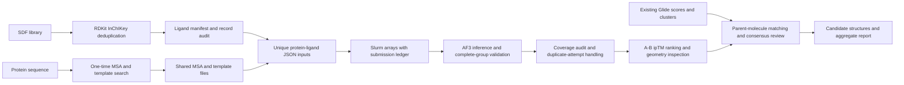

# AF3 Ligand Screen

**A reproducible protein–ligand screening workflow connecting AlphaFold 3, Slurm orchestration, structural quality assessment, and docking-based candidate review.**

[中文指南](README.zh-CN.md) · [HPC runbook](docs/HPC.md) · [Scientific methods](docs/METHODS.md) · [Evidence and limitations](docs/EVIDENCE.md) · [Portfolio guide](docs/PORTFOLIO.md)

This project grew out of a β-catenin screening campaign with a **59,635-ligand manifest**. It turns a sequence of cluster scripts into a portable workflow: prepare molecules, reuse a receptor MSA, generate traceable inputs, distribute inference, audit every sample group, and review candidates using confidence, geometry, and existing Glide clusters.


**Status:** inference completion was reported for the private campaign. A real single-ligand audit recovered all five expected samples. The full-library postprocessing audit and biological validation remain pending in this public record. The included demo uses artificial coordinates and scores, clearly separated from scientific results. See [evidence](docs/EVIDENCE.md).

## Workflow



## Engineering decisions

- **Reuse fixed inputs:** version-2 AF3 JSON references one shared unpaired MSA and shared template CIFs; `pairedMsa` is explicitly empty.
- **Track chemical identity:** canonical isomeric SMILES and full standard InChIKey, with every source record linked to a retained molecule or rejection.
- **Bound cluster load:** one GPU per array task, multiple ligands executed sequentially per task, chained arrays with a configurable concurrency limit.
- **Make failures visible:** immutable plan hashes, submission ledger, per-ligand filesystem locks, attempt directories, and completion only after every requested seed/sample is present.
- **Audit before ranking:** recognize bare and prefixed AF3 filenames, distinguish root best copies from samples, report partial groups and repeated attempts.
- **Separate confidence from validation:** interface ranking followed by contact checks, ligand pLDDT, directional PAE, protein-aligned pose consistency, and docking comparison.

## Run the public demo (CPU only)

Python 3.10+; no AF3 parameters, databases, Slurm, or GPU required:

```bash
python -m venv .venv
source .venv/bin/activate
python -m pip install -r requirements.txt
python scripts/demo.py --out demo_output
python -m unittest discover -s tests -v
python scripts/make_report.py --summary demo_output/summary \
  --geometry demo_output/geometry --synthetic --out demo_output/report
```

On Windows, use `.venv\Scripts\Activate.ps1` for activation. Use a short checkout path if your system enforces the Windows path-length limit. Reruns need a new output directory.

Expected demo audit: **4 artificial cases → 2 ranked ligands, 10 selected samples, 1 excluded duplicate attempt, 1 partial case, 1 missing case, 1 exported review structure.** This validates failure handling as well as the successful path. [Generated example report](docs/demo_report.md).

## Run a real screen

The full commands and recovery procedures are in [HPC.md](docs/HPC.md). Start with four ligands before scaling.

```bash
# Preparation environment; independently installed from the AF3 environment.
python -m pip install -r requirements-chem.txt
python scripts/prepare.py library --sdf-dir /private/library --out data/prepared
python scripts/prepare.py msa-input --fasta examples/beta_catenin.fasta --out data/receptor.json
cp config/cluster.example.sh config/cluster.local.sh
# Edit cluster.local.sh, then follow the MSA and four-ligand smoke test in docs/HPC.md.
```

An existing completed campaign can enter directly at `af3_postprocess.py summarize`; new inference submission is unnecessary. The postprocessor supports the historical `results/SHARD/lig_NNNNNN/ROUND/attempt_JOB_TASK/NAME/seed-N_sample-M/` layout.

## Repository map

| Path | Responsibility |
| --- | --- |
| `scripts/prepare.py` | SDF deduplication, record provenance, receptor input |
| `scripts/build_jobs.py` | Shared MSA/templates, unique input names and hashes |
| `scripts/workflow.py` | Execution plan, Slurm submission ledger, worker and completion checks |
| `slurm/*.slurm` | MSA, GPU inference, CPU analysis entry points |
| `scripts/af3_postprocess.py` | Coverage, confidence ranking, geometry and sample consistency |
| `scripts/merge_af3_glide.py` | Standardized-parent matching, rank agreement, cluster-based review |
| `scripts/make_report.py` | Aggregate report without molecule identities or source paths |
| `scripts/demo.py`, `tests/` | Artificial fixtures and regression tests |
| `config/cluster.example.sh` | Portable cluster configuration template |
| `docs/` | Runbook, methods, evidence, validation and portfolio guidance |

## Interpretation and scope

AF3 predicts complex structures; its confidence scores are **not binding energies or measured activity**. This project does not train or fine-tune AF3. The scientific contribution is a documented screening and evaluation workflow. Pose consistency and cross-method agreement prioritize review, while experiments are needed to establish binding or functional effects.

The general scanner reads summary files serially to avoid overwhelming shared storage. Structural inspection reads full confidence matrices only for the selected subset. More allocated CPU cores alone do not parallelize either Python loop. GPU occupancy and throughput depend on scheduling, memory, CPU availability, sequence/ligand sizes, seeds, model version and compilation.

## References and license

- [AlphaFold 3 input specification](https://github.com/google-deepmind/alphafold3/blob/main/docs/input.md): MSA/template paths and model inputs.
- [AlphaFold 3 output specification](https://github.com/google-deepmind/alphafold3/blob/main/docs/output.md): confidence outputs and samples.
- [Slurm job arrays](https://slurm.schedmd.com/job_array.html): array concurrency and dependencies.
- [AlphaFold 3 paper](https://www.nature.com/articles/s41586-024-07487-w).

The orchestration and analysis code in this repository is MIT licensed. AF3 code, model parameters, databases, Schrödinger software and external datasets are separate dependencies governed by their own terms. They are not distributed here. No private ligand library, server credentials, cluster addresses, or production result files are included.
